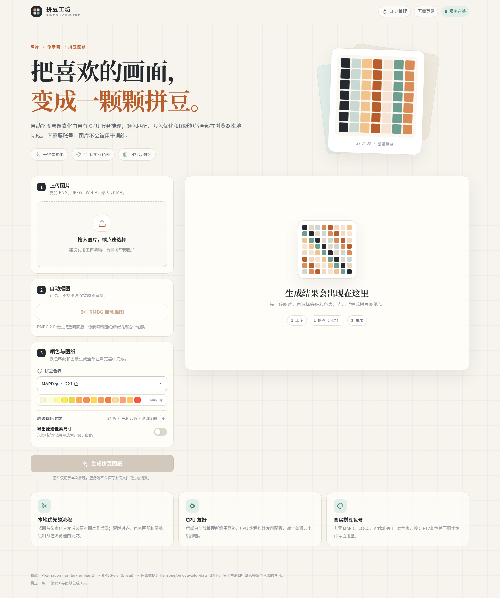

# 拼豆工坊 · Pindou Convert

把照片转换成像素画与可打印的拼豆图纸。前后端分离，无账号体系：

- **前端**完成像素化与拼豆标准化：Pixilate 引擎（网格检测、重采样、调色板、清理）+ 拼豆色表归色 + 图纸排版 + three.js 熨烫预览。
- **后端**只做可选的 RMBG-2.0 自动抠图（CPU）。
- 只有使用自动抠图时图片才会上传，且只在一次请求的内存中处理，不落盘、不建库、不需要登录。



## 架构

```
浏览器（React + Vite）
  ├─ 解码图片 / EXIF 方向 / 蒙版对齐 / 透明通道
  ├─ Pixilate 像素化（网格检测 → 重采样 → OKLab 调色板 → 清理）
  ├─ 拼豆色表标准化：限色先聚类，再按 OKLab 归到最近真实色号
  ├─ Canvas 拼豆图纸（四边坐标尺、5/10 格辅助线、中心标记、色号、用量图例）
  ├─ three.js 3D 预览（空心豆熨烫压扁：内部成方块、边缘成大圆角方块；5 种表面纹理）
  └─ 下载 PNG（像素画 / 图纸 / 3D 效果图）
        │  multipart 上传（仅自动抠图需要）
        ▼
FastAPI（CPU PyTorch）
  └─ POST /api/v1/remove-background → 1024×1024 灰度蒙版 PNG
```

像素化、色号标准化和图纸绘制都在浏览器内完成；后端不读取色表，也不生成图纸。

### 目录

```
backend/
  app/                 FastAPI 应用、RMBG 服务、中间件
  tests/               pytest
  Dockerfile
frontend/
  src/lib/pixilate/    vendored Pixilate 引擎（MIT，见其 README）
  src/lib/             色表、几何、图纸、拼豆形状、表面纹理
  src/workers/         像素化 Web Worker
  src/components/      UI（含 three.js 3D 预览）
  Dockerfile + nginx.conf
scripts/
  build-palettes.mjs   从 data/pindou-color-data 生成前端色表包
data/pindou-color-data/ 色表原始数据（MIT）
docker-compose.yml
legacy/                重构前的扁平脚本与旧输出，仅作对照，可删除
```

## 快速开始

### Docker（推荐）

```bash
cp .env.example .env
# 编辑 .env：至少设置 CORS_ORIGINS；需要用自动抠图时填写 HF_TOKEN
docker compose up -d --build
```

打开 <http://localhost:8080>。API 文档在容器内部的 `/docs`，默认不对外暴露。

也可以直接使用 GHCR 已发布的双架构镜像，不本地构建：

```bash
cp .env.example .env
docker compose pull
docker compose up -d
```

首次构建会安装 CPU 版 PyTorch 与 RMBG 依赖，镜像较大；RMBG 权重在首次抠图时下载到 Hugging Face 缓存 volume，不写进镜像。

### 多架构镜像与 CI

`.github/workflows/docker.yml` 会在 push 到 `main`、推送 `v*` 标签或手动触发时，构建并推送 `linux/amd64` + `linux/arm64` 双架构镜像到 GHCR：

```text
ghcr.io/sigmayl/pindou-backend:latest
ghcr.io/sigmayl/pindou-frontend:latest
```

ARM64 上使用 PyTorch 官方 CPU wheel（`torch==2.15.0+cpu` / `torchvision==0.29.2+cpu` 均提供 aarch64 构建），不依赖 GPU。首次构建 ARM 镜像会通过 QEMU 模拟，耗时较长；后续走 GitHub Actions 缓存。

本地用 Buildx 构建双架构（需要 Docker Buildx 插件）：

```bash
docker buildx bake -f docker-bake.hcl
# 只构建 arm64 并加载到本地：
docker buildx bake -f docker-bake.hcl --set "*.platform=linux/arm64" --load
```

`.github/workflows/ci.yml` 负责后端 pytest + ruff 与前端 Vitest + 类型检查 + 生产构建。

### 本地开发

需要 Python 3.12、Node.js ≥ 20.19。

```bash
make setup          # 创建 .venv，安装后端与前端依赖
make palettes       # 从 data/ 生成前端色表（仓库已包含生成结果）
```

开两个终端：

```bash
make dev-backend    # http://127.0.0.1:8000
make dev-frontend   # http://localhost:5173
```

Vite 会把 `/api` 代理到 `127.0.0.1:8000`。若后端在别处，设置 `VITE_DEV_BACKEND` 或在 `.env` 中设置 `VITE_API_BASE_URL`。

### 启用自动抠图（RMBG-2.0）

RMBG-2.0 是 gated 模型：

1. 登录 Hugging Face，在 [briaai/RMBG-2.0](https://huggingface.co/briaai/RMBG-2.0) 接受访问条款。
2. 创建 read token，填入 `.env` 的 `HF_TOKEN`。
3. 本地开发额外安装依赖：`make setup-rmbg`。
4. 重启后端。Docker 构建默认安装 RMBG 依赖（`INSTALL_RMBG=true`）。

不启用时设置 `RMBG_ENABLED=false`，前端会隐藏/禁用抠图按钮，直接生成像素画。RMBG 模型权重会缓存到 Docker volume `huggingface-cache`。

首次抠图可能需要下载数百 MB 模型，耗时取决于网络；配置好 token 后可设置 `RMBG_PRELOAD=true`，让容器在启动阶段完成下载与加载。

## API

所有接口返回 JSON；图片以 `data:image/png;base64,...` 返回。错误统一为：

```json
{ "error": { "code": "invalid_image", "message": "..." } }
```

### `POST /api/v1/remove-background`

`multipart/form-data` 的 `image`。返回 1024×1024 灰度蒙版：

```json
{ "mask": "data:image/png;base64,...", "width": 1024, "height": 1024, "elapsed_ms": 11534.7 }
```

前端把蒙版缩放到原图尺寸并用于透明抠图。该接口需要 `RMBG_ENABLED=true` 且模型可加载。

### 其他

- `GET /healthz`：存活探针。
- `GET /readyz`：RMBG 已启用且预加载失败时返回 503；未预加载时只要服务可连接即为就绪。
- `GET /api/v1/info`：版本、限制、RMBG 是否启用/已加载。
- `GET /docs`：OpenAPI 文档（生产环境建议只在内网开放）。

## 配置

| 环境变量 | 默认 | 说明 |
| --- | --- | --- |
| `APP_ENV` | `production` | 环境标识 |
| `LOG_LEVEL` | `INFO` | 日志级别 |
| `TORCH_THREADS` | `min(8, CPU)` | PyTorch CPU 线程数（兼容旧的 `PIXEL_THREADS`） |
| `INFERENCE_CONCURRENCY` | `1` | 同时进行的推理数；CPU 上建议 1 |
| `INFERENCE_WAIT_TIMEOUT` | `120` | 排队等待秒数，超时 503 |
| `MAX_UPLOAD_BYTES` | `20971520` | 上传体积上限 |
| `MAX_IMAGE_PIXELS` | `30000000` | 解码像素上限 |
| `RMBG_ENABLED` | `true` | 是否启用抠图接口 |
| `RMBG_PRELOAD` | `false` | 启动时预加载 RMBG |
| `RMBG_MODEL_ID` | `briaai/RMBG-2.0` | 模型 ID |
| `RMBG_REVISION` | 固定 commit | 避免上游漂移 |
| `RMBG_LOCAL_FILES_ONLY` | `false` | 只使用本地缓存 |
| `HF_TOKEN` | 空 | gated 模型访问令牌 |
| `CORS_ORIGINS` | 本地开发地址 | 逗号分隔；同源部署可不配 |
| `TRUSTED_HOSTS` | `*` | Host 白名单 |
| `TRUST_PROXY_HEADERS` | `false` | 是否信任 `X-Forwarded-For` |
| `RATE_LIMIT_PER_MINUTE` | `30` | 每 IP 每分钟请求数，0 关闭 |
| `RATE_LIMIT_BURST` | `10` | 令牌桶容量 |

前端构建变量：

- `VITE_API_BASE_URL`：默认空，表示同源 `/api`。前后端分开域名时设为 `https://api.example.com`。
- `VITE_DEV_BACKEND`：仅 Vite 开发服务器使用。

## 前端算法说明

- **像素化**：使用 vendored 的 [Pixilate](https://github.com/Shilo/pixilate) 引擎。它先检测像素网格（含平滑放大的回退），再按网格重采样、在 OKLab 空间生成调色板（Wu 箱分割 + Lloyd + Ward 合并）、清理孤立像素，最后拉伸到目标格数；输出 alpha 为二值，透明格直接留空。
- **拼豆标准化**：拼豆色表作为 Pixilate 的 `palette` 传入，调色板阶段按 OKLab 色差把每个格子归到最近的真实色号，输出的 RGB 就是色表里的精确字节。
- **限色**：`colors` 先按指定簇数聚类，再把每个簇映射到最近色号，因此限色与标准化一步完成，不会出现“先归色再限色”导致的色号漂移。
- **图纸**：每个可见格一颗豆；格内显示色号（空间足够时），下方图例按色号统计数量。
- **3D 熨烫**：每颗豆由空心圆柱网格生成，熨烫程度从“未熨烫”连续过渡到“压平”。内部豆被压成填满格子的方块，与邻居无缝相接；朝向空位的边和角保留大圆角与柔和肩部，因此边缘与内部使用不同的轮廓。
- **表面纹理**：5 种熨烫表面——正常（细纹理）、细闪（细纹理 + 小闪片）、粗闪（细纹理 + 更大更强的闪片）、澡巾（中纹理）、毛巾（大纹理）。纹理为可平铺的法线贴图，闪片由片元着色器按世界坐标程序化生成，整幅作品共享同一片压印表面。

像素化在 Web Worker 中执行，避免阻塞界面；工作图最长边限制为 2048 像素，以降低手机内存占用。

## 测试

```bash
make test
```

- 后端：上传校验、RMBG 未启用时的 503、配置兼容、API 行为。
- 前端：Pixilate 网格/透明/限色/确定性、色表标准化、等级几何、图纸统计、拼豆形状与内外轮廓、表面纹理平铺与顺序。

端到端手工检查：

```bash
make dev-backend
make dev-frontend
# 浏览器打开 http://localhost:5173，上传图片 → 生成 → 下载图纸
```

## 生产部署清单

1. **HTTPS**：在云负载均衡或外层 Nginx/Caddy 终止 TLS；前端容器只监听 80。
2. **只暴露前端**：Compose 中 backend 使用 `expose`，不要直接映射到公网；如必须暴露，限制安全组并配置 `TRUSTED_HOSTS`。`frontend/nginx.conf` 假设 Compose 服务名为 `backend`；若前后端分开部署，设置 `VITE_API_BASE_URL` 并调整/移除 `/api` 代理。
3. **CORS**：同源部署不需要；跨域时设置精确的 `CORS_ORIGINS`，不要使用 `*` 配合凭证。
4. **限流**：后端自带按 IP 令牌桶；外层可再加 Nginx `limit_req` / 云 WAF。
5. **上传限制**：按业务调整 `MAX_UPLOAD_BYTES` / `MAX_IMAGE_PIXELS`，并同步外层 `client_max_body_size`。
6. **资源**：后端只加载 RMBG（约 0.5–1 GB 内存）；CPU 推理并发保持 1，按 CPU 核数设置 `TORCH_THREADS`。像素化在前端完成，服务器不需要额外算力。
7. **健康检查**：`/healthz` 用于存活，`/readyz` 在 RMBG 预加载失败时返回 503。
8. **日志**：stdout 结构化前缀 + `X-Request-ID`；不要记录图片内容。容器日志交给平台收集。
9. **数据**：应用不写上传文件、不建数据库；如启用 RMBG，HF 缓存 volume 需要持久化。
10. **模型许可**：见 `THIRD_PARTY_NOTICES.md`。Pixilate 为 MIT；RMBG-2.0 标注非商业使用。上线前请自行确认商业授权。

## 故障排查

| 现象 | 处理 |
| --- | --- |
| `/readyz` 503，日志 `RMBG model failed to load` | 检查 `HF_TOKEN`、模型条款、网络与 `RMBG_LOCAL_FILES_ONLY`；或先设 `RMBG_PRELOAD=false` 延迟加载 |
| 抠图返回 503 `model_unavailable` | 检查 `RMBG_ENABLED`、`HF_TOKEN`、是否已接受模型条款；或安装 `requirements-rmbg.txt` |
| 前端显示“服务未连接” | 后端未启动、端口不对，或 `VITE_API_BASE_URL` 配错（不影响本地像素化） |
| 抠图时 422 `invalid_image` | 图片损坏/格式不支持/超过像素或体积限制 |
| 抠图时 503 `service_busy` | 推理排队超时；降低并发、提高 `INFERENCE_WAIT_TIMEOUT` 或扩容 |
| 图纸中文显示为方框 | 服务器端不渲染图纸；问题在用户浏览器字体，安装/启用中文字体即可 |
| 图纸下载无反应 | 浏览器拦截 blob 下载；允许本站下载后重试 |

## 第三方与许可

- Pixilate 像素化引擎：<https://github.com/Shilo/pixilate>，MIT，固定提交 `4a24bba1a67e03493921618f7ff5c8d2c0b77565`。vendored 源码与本地修改见 `frontend/src/lib/pixilate/`。
- three.js（3D 预览）：<https://github.com/mrdoob/three.js>，MIT。
- RMBG-2.0：<https://huggingface.co/briaai/RMBG-2.0>（非商业使用许可，需接受条款）。
- 拼豆色表：<https://github.com/HansBug/pindou-color-data>，MIT，固定提交 `178dafbc9e77d3de556550dbd058270200129186`。许可证见 `frontend/public/licenses/`。

本项目应用代码采用 MIT 许可证（见 [LICENSE](LICENSE)）；模型权重与色表另见 [THIRD_PARTY_NOTICES.md](THIRD_PARTY_NOTICES.md)。
